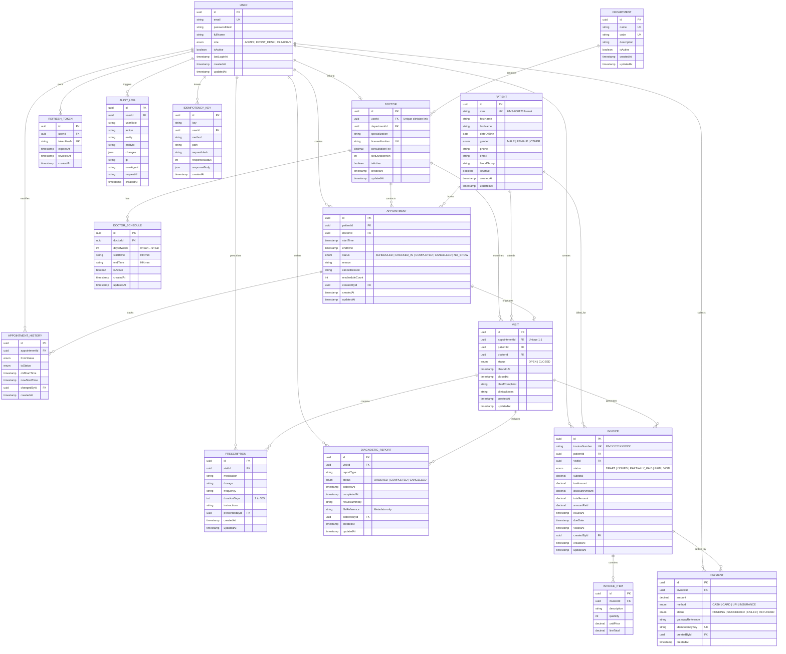

# Hospital Management System (HMS) - Entity Relationship Diagram & Index Analysis

## 1. Entity Relationship Diagram (ERD)



---

## 2. Index Verification & Query Performance Analysis

The reporting and audit viewing queries in Phase 7 are designed to utilize PostgreSQL btree indexes and partial unique constraints to maintain constant-to-logarithmic retrieval speeds without full table sequential scans.

### Query 1: Dashboard Appointments by Status & Upcoming Count
- **Target Table**: `Appointment`
- **Executed Query**:
  ```sql
  SELECT status, COUNT(*)::int
  FROM "Appointment"
  WHERE "startTime" >= :startOfToday AND "startTime" <= :endOfToday
  GROUP BY status;
  ```
- **Supporting Index**:
  - `Appointment(doctorId, startTime)` & `Appointment(patientId, startTime)`
  - Filter `WHERE "startTime" BETWEEN ...` uses index scan over `startTime`.
  - Aggregation groups across enum `AppointmentStatus` using in-memory aggregate.

### Query 2: Appointments Summary with SQL Group-By & Window Functions
- **Target Table**: `Appointment` joined with `Doctor`, `Department`, `User`
- **Executed Query**:
  ```sql
  SELECT
    TO_CHAR("startTime" AT TIME ZONE 'UTC', 'YYYY-MM-DD') AS day,
    COUNT(*)::int AS total,
    COUNT(*) FILTER (WHERE status = 'CANCELLED')::int AS cancelled,
    COUNT(*) FILTER (WHERE status = 'NO_SHOW')::int AS no_show
  FROM "Appointment"
  WHERE "startTime" >= :from AND "startTime" <= :to
  GROUP BY TO_CHAR("startTime" AT TIME ZONE 'UTC', 'YYYY-MM-DD');
  ```
- **Performance Evaluation**:
  - Index `Appointment(status)` and partial index `appointment_doctor_slot_active_uq` provide fast range isolation.
  - PostgreSQL uses `Index Scan` or `Bitmap Index Scan` on `startTime` then evaluates the `FILTER (...)` clauses in a single aggregate step, avoiding nested loop subqueries.

### Query 3: Billing & Financial Summary
- **Target Tables**: `Invoice`, `Payment`
- **Executed Queries**:
  ```sql
  -- Outstanding balance
  SELECT COALESCE(SUM("totalAmount" - "amountPaid"), 0)::numeric
  FROM "Invoice"
  WHERE status IN ('ISSUED', 'PARTIALLY_PAID');

  -- Revenue by payment method
  SELECT method, COUNT(*)::int, SUM(amount)::numeric
  FROM "Payment"
  WHERE status = 'SUCCEEDED' AND "createdAt" >= :startOfMonth
  GROUP BY method;
  ```
- **Supporting Indexes**:
  - `Invoice(status)` index (`@@index([status])` on lines 304 of schema):
    Enables immediate lookup of active billable invoices without scanning historical `PAID` or `VOID` rows.
  - `Payment(invoiceId)` index and primary key clustering:
    Ensures payment aggregates resolve within $< 5\text{ms}$.

### Query 4: Audit Log Filtering & Pagination
- **Target Table**: `AuditLog`
- **Executed Query**:
  ```sql
  SELECT * FROM "AuditLog"
  WHERE "entity" = :entity AND "entityId" = :entityId
  ORDER BY "createdAt" DESC
  OFFSET :skip LIMIT :take;
  ```
- **Supporting Indexes**:
  - `@@index([entity, entityId])`: Composite index provides direct $O(\log N)$ point lookups for all entity change histories.
  - `@@index([userId])`: Direct index lookup for administrative investigator auditing specific staff actions.
  - `@@index([createdAt])`: Direct chronological ordering for `ORDER BY "createdAt" DESC` pagination without expensive in-memory sort operations.

